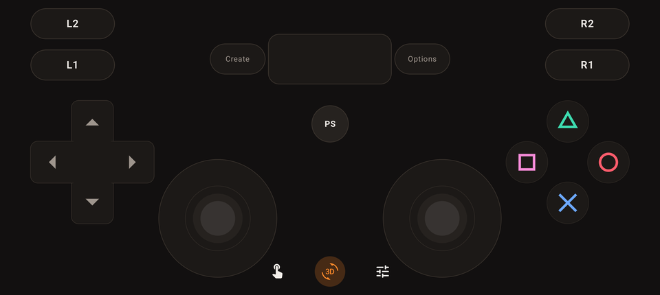
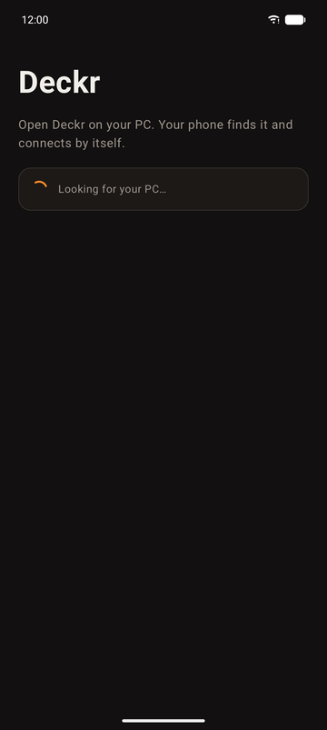
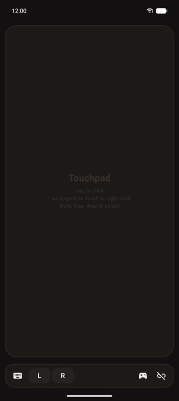
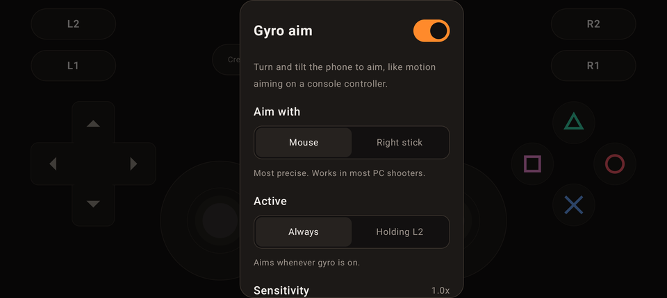
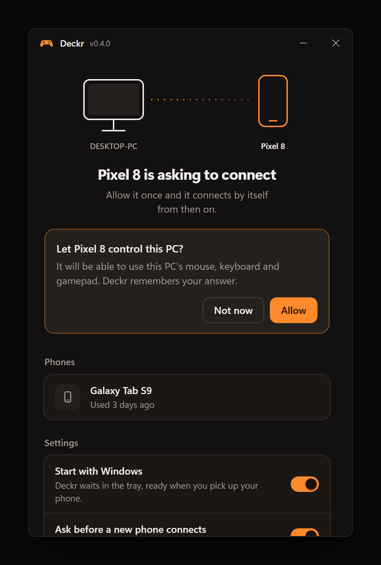
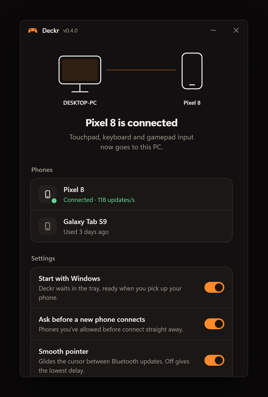

# Deckr

Use your Android phone as a touchpad, keyboard and gamepad for your Windows PC, over Bluetooth.

- **Touchpad:** tap to click, two fingers to scroll or right-click, hold and drag to select.
- **Keyboard:** type on your phone and it appears on the PC as you type.
- **Gamepad:** two touch joysticks and PlayStation-style buttons, seen by Windows as a DualShock 4 or Xbox 360 controller.
- **Gyro aim:** turn and tilt the phone to aim in shooters, as mouse or right-stick input.

No pairing in Windows settings needed. The first time a phone connects, Deckr on the PC asks you to allow it.

## Screenshots

<p align="center">
  
</p>

<p align="center">
  
  &nbsp;
  
</p>

<p align="center">
  
</p>

<p align="center">
  
  &nbsp;
  
</p>

## Install

Download both from the [latest release](../../releases/latest):

1. **PC:** run `Deckr-Setup.exe`. Deckr lives in the tray and starts with Windows.
2. **Phone:** install `Deckr.apk` (Android 8 or newer).
3. Open Deckr on the phone. It finds your PC and connects. Click **Allow** on the PC the first time.

Gamepad mode needs the free [ViGEmBus](https://github.com/nefarius/ViGEmBus/releases/latest) driver on the PC. Deckr points you to it if it's missing.

## Project

| Folder     | What it is |
|------------|------------|
| `android/` | Phone app (Kotlin, Jetpack Compose) |
| `desktop/` | Windows app (Tauri 2: Rust backend in `src-tauri/`, UI in `ui/`) |

**Build locally**

```bash
# Windows app (needs Rust, Node and the Visual Studio C++ tools)
cd desktop && npm ci && npx tauri build

# Android app
cd android && ./gradlew assembleRelease
```

## Releases

Pushing a tag like `v0.4.1` runs `.github/workflows/release.yml`, which builds both apps and
publishes them as a GitHub release. The APK is signed with the key stored in these repository secrets:
`ANDROID_KEYSTORE_BASE64`, `ANDROID_KEYSTORE_PASSWORD`, `ANDROID_KEY_ALIAS`, `ANDROID_KEY_PASSWORD`.
